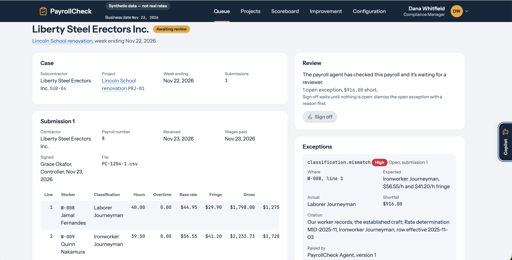
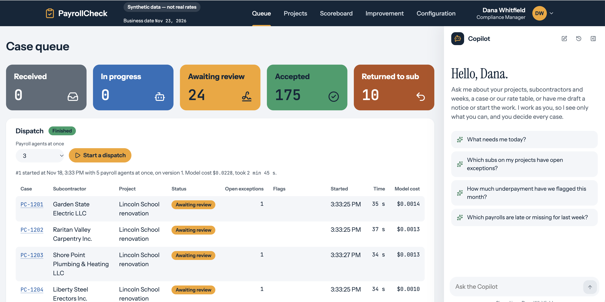

# PayrollCheck

PayrollCheck reviews the certified payrolls that subcontractors file on New Jersey public works jobs, for a general contractor that's on the hook if it passes along one that underpays. A reviewer uploads each payroll as a CSV, and the payroll agent checks every line of it: the rate for the trade and county, fringes, overtime, the arithmetic, apprentices, the subcontractor's registration, and whether the payroll was filed on time and in sequence. Every exception cites the rate record or rule it came from, with any shortfall worked out to the cent in code. The agent flags; it never accepts. A reviewer signs off or sends back every case, and reviewers can ask the PayrollCheck Copilot about their projects. It's built for Pinelands Builders, a fictional general contractor.

`docs/SPEC.md` has the whole product, and `CONTEXT.md` the words it uses.

## Status

PayrollCheck was built in seven stages, listed in [docs/ROADMAP.md](docs/ROADMAP.md), from Ed Donner's UnderCover, a claims platform for a fictional travel insurer. [docs/STATUS.md](docs/STATUS.md) says what each built. It runs on the laptop, and in production on AWS AgentCore: the backend and dashboard, and the context layer, on Lambda, the payroll agent and the Copilot on AgentCore Runtime, their tools through an AgentCore Gateway whose Policy allows each caller only its own tools, and the Copilot's memory in AgentCore Memory.

## Running it

You need uv, Python 3.12, Node 26 and a Supabase project.

1. `uv sync` and `npm install` at the root of the repo install everything, including a git pre-commit hook.
2. Create `.env` at the root of the repo. `docs/TECH_STACK.md` lists what it holds: the OpenRouter key (`OPENROUTER_API_KEY`), Supabase's session pooler connection string (`DATABASE_URL`), the Supabase project's address and publishable key (`VITE_SUPABASE_URL`, `VITE_SUPABASE_PUBLISHABLE_KEY`), the password for signing in (`REVIEWER_PASSWORD`), the agent's API key (`PAYROLLCHECK_API_KEY`, a random value of at least 32 characters, such as one from `uv run python -c "import secrets; print(secrets.token_urlsafe(32))"`) and the Langfuse keys.
3. `npm run seed` rebuilds the database from `data/`.
4. `npm run dev` starts the backend on port 8000, the agent on port 8080, the Copilot on 127.0.0.1:8081, the context layer on port 8006 and the dashboard on http://localhost:5173.

## Deploying it

The provisioning runbook in `deploy/` stands PayrollCheck up on AWS AgentCore and a Supabase project from nothing, and can run again without changing anything. `deploy/RUNBOOK.md` is its checklist: an IAM user and AWS CLI profile, then a step a command (`uv run --env-file .env -m deploy <step>`), then a smoke check on the deployed product. `uv run --env-file .env -m deploy show` lists what it made, and `uv run --env-file .env -m deploy teardown --yes` deletes it. It creates resources that cost money; they keep running until you tear them down.

## Checking it

`npm run check` runs every check: lint, types, unit tests with 80% coverage and the end-to-end tests. It needs no network and never reads `.env`. `docs/STATUS.md` has the details, and `docs/PROCESS.md` how the work is planned, built and checked.

## Synthetic data

All people, firms, projects and rates are invented. The rates are not real NJDOL rates. PayrollCheck is not legal advice, and its rules need review by NJ counsel before real use.

## Credit

Built on the UnderCover project from Ed Donner's AI FDE course (commit ecca35dd).
